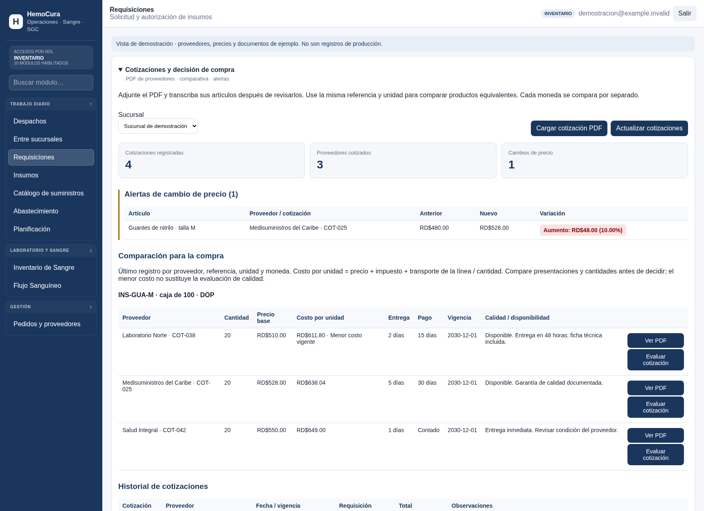

# Cotizaciones y decisión de compra

Menú desplegable **Cotizaciones y decisión de compra** en Inventario, Requisiciones y Proveedores. Usa los permisos existentes PURCHASE_VIEW, PURCHASE_WRITE y PURCHASE_APPROVE y las sucursales autorizadas. No añade usuarios ni cambia identidades o configuración de conexión.

## Uso

1. Seleccionar sucursal, proveedor activo/condicional y, opcionalmente, una requisición de esa sucursal.
2. Adjuntar PDF (máximo 5 MB) y registrar número, fechas, moneda, entrega y condiciones de pago. Transcribir y revisar cada artículo: referencia común, presentación/unidad, cantidad, precio sin impuesto, impuesto porcentual y transporte total asignado a la línea. Los PDF escaneados también se conservan; no se realiza OCR ni extracción automática.
3. Usar referencias y unidades idénticas solo para productos equivalentes. La comparación toma el último registro por proveedor/referencia/unidad/moneda/sucursal, prioriza ofertas vigentes y ordena por costo unitario incluido impuesto y transporte. Monedas y unidades distintas nunca se mezclan. Las cantidades siguen visibles: una oferta con otra escala de compra requiere revisión.
4. Al cargar o actualizar, las diferencias de precio base frente al registro anterior del mismo proveedor generan alertas de aumento o reducción, importe y porcentaje. El primer precio establece la base; una base cero muestra porcentaje no calculable. Las alertas se reconstruyen del historial inmutable y no requieren otro almacenamiento. No se envían correos ni notificaciones fuera de la aplicación.
5. Consultar PDF, vigencia, entrega, pago y observaciones de calidad/disponibilidad. Registrar la decisión con justificación de al menos 10 caracteres. La decisión elige la **cotización completa**, conserva responsable y fecha, y no sustituye la aprobación de la orden ni aumenta inventario.

## Persistencia y publicación

La migración `supabase/migrations/20261107000948_supplier_quotations.sql` se aplicó en la base de producción HEMOCURA después de verificar sus dependencias de compras y requisiciones. La interfaz se publica por el canal existente de GitHub Pages al integrar estos archivos en main. Las pruebas funcionales usan datos sintéticos y no cargan cotizaciones de ejemplo en producción.

Los PDF se guardan en base64 en la fila protegida por RLS para que documento y datos se inserten de forma atómica. Los listados excluyen el contenido binario; se descarga solo al solicitarlo. Base64 añade aproximadamente 33% de espacio y esta solución tiene límite de 5 MB por cotización. Para gran volumen conviene migrar los documentos a un bucket privado manteniendo las mismas autorizaciones. El PDF y los importes se conservan juntos; las correcciones se registran como una nueva cotización (otro número o fecha), sin sobrescribir el historial.

Los insertos permiten solo columnas de negocio: identidad y fecha de registro provienen del servidor. No se permiten UPDATE/DELETE a authenticated, ni lectura anónima. Las decisiones requieren permiso de aprobación, sucursal coincidente, proveedor activo/condicional y vigencia actual en America/Santo_Domingo. Las políticas de proveedores/requisiciones existentes también deben permitir su consulta al rol correspondiente. La validación del PDF verifica cabecera y tamaño, no analiza su contenido como antivirus.

## Verificación local

- `node tests/quotations/domain.test.mjs`
- `python tools/quotations_postgres_runner.py` (PostgreSQL desechable, datos sintéticos, sin producción).
- `node tools/quotations_browser_runner.cjs` (Chromium, datos sintéticos, tráfico externo bloqueado).
- `python tools/javascript_syntax_gate.py`

Se cubren costos, monedas/unidades/sucursales separadas, caducidad, precios con base cero, aumentos/reducciones, carga y descarga del PDF, vínculo a requisición, justificación, escape HTML, historial inmutable, columnas de auditoría protegidas, usuarios inactivos, solo lectura y aislamiento entre sucursales.

## Pantalla de demostración

Captura de la interfaz real de Requisiciones con datos sintéticos identificados: tres proveedores, cuatro cotizaciones y una alerta de aumento del 10%. Estos registros no se insertaron en producción.

